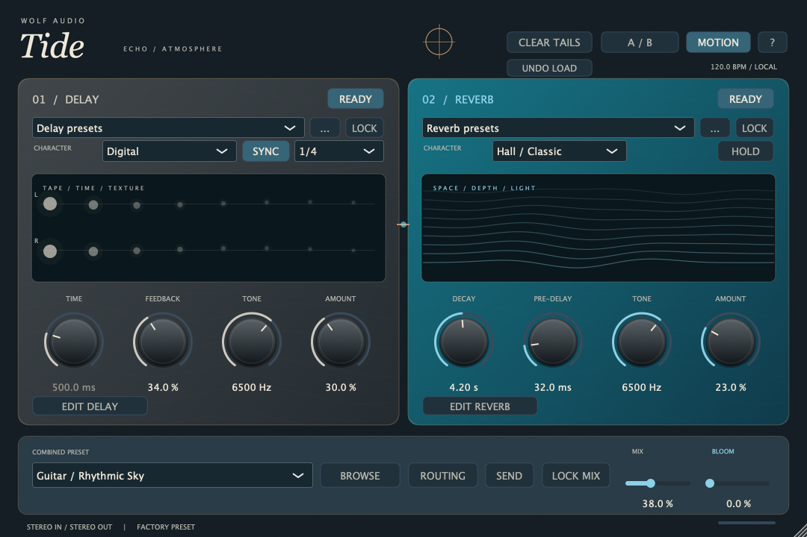

# Wolf Tide 1.2.0

Stereo delay into reverb by Wolf Audio: grey delay, blue reverb, independent engines and presets, and combined instrument presets.

**Current status:** native Mac universal AU/VST3/Standalone 1.2.0 is installed and builds successfully, but the effect audit found reproducible functional defects. Read the [effect audit and repair order](docs/TIDE-1.2.0-EFFECT-AUDIT.md) before treating this as a finished release. This archive adds documentation/assets, not fixes to those defects.



## Start here

- [Backup and project index](docs/BACKUP-INDEX.md): source, research, measurements, screenshots and remaining local artifacts.
- [Current project memory](docs/PROJECT-MEMORY.md): verified state, compatibility requirements and next work.
- [1.2 release notes](docs/RELEASE-1.2.0.md) and [validation actually performed](docs/VALIDATION-1.2.0.md).
- [Complete effect audit](docs/TIDE-1.2.0-EFFECT-AUDIT.md): all nine delay and eleven reverb choices, primary-source comparisons and reproducible diagnostics.
- [Original design research](docs/RESEARCH-AND-DESIGN.md), [update specification](docs/TIDE-1.2-UPDATE-SPEC.md) and [implementation handoff](docs/TIDE-1.2-GO-HANDOFF.md). The latter two are historical planning documents; the audit records later findings.
- [92 exported presets](Factory-Presets): 52 combined programs and 40 independent side starters, not a claim that every sound has been optimized on instrument recordings.
- [Test logs](docs/test-logs) include historical failed attempts and final passing checks. Use the versioned validation document to interpret them.

## Build

CMake 3.22+ and a C++17 compiler are required. CMake uses the local JUCE archive if supplied, otherwise fetches JUCE at pinned commit `29396c22c93392d6738e021b83196283d6e4d850`. The 22.8 MB vendor archive is retained on the build Mac, not included in this GitHub text/source backup. See [artifact checksums](docs/ARTIFACT-MANIFEST-2026-10-27.json).

```sh
cmake -S . -B build -DCMAKE_BUILD_TYPE=Release
cmake --build build --config Release --parallel 2
ctest --test-dir build -C Release --output-on-failure
```

Dependency-free DSP checks:

```sh
cmake -S . -B build-dsp -DTIDE_DSP_ONLY=ON -DCMAKE_BUILD_TYPE=Release
cmake --build build-dsp --parallel 2
ctest --test-dir build-dsp --output-on-failure
```

AU requires macOS; Windows is not validated. Passing these suites does not override the audit's known behavioral failures.

## Install and distribute

The built unsigned installer remains at `~/Downloads/Wolf-Tide-1.2.0-unsigned.pkg` on the build Mac; it is not a GitHub release asset. SHA-256: `a4f18801e38b6bfea769db42120b15eae1cd7f20ce214c58b313a52cd1dff983`.

`bash scripts/package-mac.sh` builds/tests universal arm64/x86_64 bundles and creates a versioned installer. Bundles are ad hoc signed; Developer ID signing/notarization requires configured Apple identities and a notary profile. The package installs system-wide while the current automatic installation uses per-user locations; verify/retire shadowing older copies before distribution.

## License

AGPL-3.0-or-later. Preserve corresponding source and notices when redistributing. JUCE retains its own terms; see [JUCE licensing](docs/JUCE-LICENSE.md). No proprietary Strymon/Eventide/Hologram DSP was recovered or imported. Referenced third-party code is research, not automatically incorporated or relicensed.
