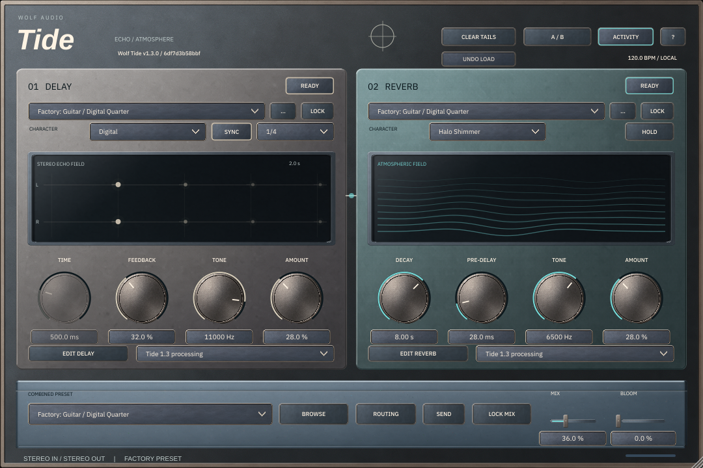

# Deep Current Studio Edition — implementation and Linux validation

Native implementation build **`6df7d3b58bbf`**, Tide **1.3.0**. Continued on
`ui/deep-current-complete` from recovery `46b47a90147d882ec267f83b2493a014f3d93163`,
then preserved the correction-import commit. No branch reset or audio upgrade.
Validation performed October 30, 2026 PDT / October 31 UTC.

The interface now uses the Studio Edition family across the main editor, five
modern machine pages, three legacy expanded panels, all three preset browser
scopes, selectors, menus, editable values, tooltips, quick guide and plugin-owned
alerts. This is reviewable native implementation with Linux evidence. Mac release
validation and final display/color approval remain pending.



[Before/after main](evidence/implementation/before-after-main.png) ·
[Before/after browser](evidence/implementation/before-after-browser.png) ·
[All-view screenshot index](evidence/implementation/SCREENSHOTS.md)

## Artwork and native rendering

- Inspected the recovered review sheets and production sources; retained all 29
  recovered originals byte-for-byte. There is no duplicate generation batch.
- Actual-size review exposed excessive broad highlights. Four bounded FLUX 3 Image
  correction submissions were quoted at 3 credits each (12 maximum): three
  completed images and one failed initial chassis request. Current parameters and
  quotes were checked before submission. Actual billing/refunds were not audited.
  See [correction jobs](correction-jobs.json) for complete prompts, references,
  status, quotes and URLs. All requests preserve material master M02,
  `b8504d01-4be3-41cb-b74f-2c3e574b3ff6`.
- Three correction originals were imported by the existing GitHub recovery path,
  inspected locally and recorded in the separate immutable correction receipt.
  The local network could not fetch Higgsfield's CDN; the existing GitHub Actions
  importer completed successfully. No other image generator was used.
- Prepared **17 PNG resources**, **23,049,216 decoded bytes (21.98 MiB)**, with
  reviewed crops, exterior flood masks, dimensions, SHA-256 hashes, slice margins
  and intended controls in the [production manifest](asset-production-manifest.json)
  and [runtime manifest](../../assets/tide/deep-current-studio/runtime/manifest.json).
  No decorative material was painted, recolored, relit or reconstructed in code.
- The universal cap has no baked pointer or arc. One fixed-lit cap is reused at
  all sizes; the accurate native pointer/value arc moves independently. Small
  state skins use consistent reviewed crop geometry and native borders/ticks.
- H08 selector attempts with baked arrows remain superseded. Actual-size review
  also rejected the recovered H08 interiors as too busy. Fields reuse the accepted
  shallow-inset H07 family, with explicit aliases and native arrows/focus/state.
  H12's optional contour is omitted to avoid competing with live displays.
- Native labels, values, units, precision, focus indicators, semantic glyphs,
  parameter arcs/pointers, output meter and state-driven wave/tap displays remain
  native. STATIC / ACTIVITY / MOTION, the existing timers and dirty-region repaint
  decisions are preserved. No full-editor animation repaint was introduced.
- Embedded IBM Plex Sans Regular/Medium supplies consistent functional typography;
  the original italic Tide treatment and Wolf Audio identity remain. Font source
  hashes and SIL OFL are included. Mac package staging now includes the font license.

The generated broad highlights remain lighter and less saturated than the plan's
numerical palette targets. Native headings/Character/Combined Preset captions use
dark ink on the bright areas; primary controls retain warm ivory. This improves
readability without repainting materials. These images are integrated for native
review; exact graphite/teal color matching is **not certified**. Final calibrated
Mac display review may require a further specifically quoted Higgsfield correction.

## Preservation and behavior

The historical recovery's 220 unchanged hashes established the pre-implementation
freeze. Implementation intentionally changes five of its six authorized visual/build
files; `Source/PluginEditor.h` is still identical. Validation now reports those
changes separately while enforcing all **214 protected processing, parameter and
preset hashes**. The frozen baseline is
`e2a6ad644573569ba130d145403466cdd410c17f`, build `9c1e62f44667`.

`check-deep-current.py` also verifies 14 editor-method invariants covering layout,
bindings, handlers, timer and visualization semantics. Only two narrowly normalized
additions assign the shared visual theme to callout shells. Processing sources,
parameter definitions, factory presets, state, IDs, routing, gain, latency, tails,
bypass and automation implementation are unchanged.

## Checks actually run

| Check | Result / evidence |
|---|---|
| Linux Release build | Standalone, VST3 and test targets built; build log included |
| CTest | **12/12 passed**, 43.31 s; installer, artwork, DSP, update, models, repairs, modern DSP/stress/controls, host, UI, modern host |
| Recovery guard tests | **2/2 passed**; visual-change permission cannot bypass protected processing |
| Source/behavior preservation | **214 protected files + 14 editor invariants pass** |
| Immutable resources | **29 recovered + 3 correction originals**, 17 exports, 5 aliases and 3 font/license files verify |
| Audio comparison | **64/64 programs byte-identical**, 48 kHz, 256 samples, 12,582,912 bytes |
| Linux VST3 pluginval | Strictness **5**, fixed seed `0x68c33f2`, **SUCCESS**, including editor and editor automation |
| GUI capture | **74 final snapshots** plus 70 baseline snapshots; details below |
| Mac scripts | Shell syntax checks and existing installer unit suite pass; native Mac execution unavailable |

The deterministic render uses 96 stereo blocks per program: 48 stimulus blocks,
then 48 silent input blocks. Baseline and candidate SHA-256 are both
`10667ab972dc01517d67d20c9a52d37592bb79cee6177ca84d73713f9f8df728`.
This finite render is not a new long-tail listening test. Protected source hashes
and the existing DSP/host suites provide separate preservation evidence.

The UI/host suites exercise all 64 combined programs, 50 side starters, 206 portable
presets, lock combinations, recall/migration, Undo Load, A/B, selector synchronization,
browser save/load and parameter automation paths. Modern control tests cover all
12 Delay and 13 Reverb models and the independent slots. Added visual regression
checks cover transparent accessibility labels, visible ivory tooltip text, expanded
page heading refresh, the 8-MiB cache bound and oversized-scale cache bypass.
Screenshot review caught and fixed invisible tooltip text and an overlapping hidden
accessibility label in alerts. An integrity check briefly ran during export rewriting;
it rejected the in-progress file, then passed after preparation finished. The final
12-suite run was performed after all exports were complete.

Raw logs, hashes and machine details are under [evidence/implementation](evidence/implementation/).

## View coverage and limits

Captured main sizes 900×600, 1080×720 and 1620×1080; simulated 2× at 1080 and
1620; Delay A/B, Reverb A/B and Routing/global; full scrollable contents; all 25
algorithm-specific A-slot views and controls; legacy Delay/Reverb/Routing; combined,
Delay and Reverb browser scopes; shared native states/menu/tooltip/value-entry
samples; a warning-style fixture; and the **actual quick guide** opened through
its production callback. Shared B-slot controls use the same renderer and have
separate behavior coverage.

The corrected chassis/panels and some small skins are upsampled at the largest
simulated 2× size; the capture proves rendered geometry, not native 4K source detail.
Physical Retina sharpness remains unverified.

Full-content snapshots include transparent parent-inherited regions and are not
standalone window composites. Menu/tooltip/state fixtures call the production
LookAndFeel directly. The active-outline sample demonstrates latched styling;
it does not prove physical keyboard focus traversal. Warning text is a fixture,
not evidence that an OS file-picker error was exercised. Native OS file pickers
retain platform styling. Manual favorites/recent/empty/error interaction, physical
keyboard traversal and screen-reader review remain pending in a real host.

## Performance

Measured on Linux x86_64 / GCC 14.2 / JUCE 8.0.12, Xvfb software rendering,
a two-CPU quota and 8-GiB memory limit. Each case uses three alternating
candidate/baseline trials, 48 kHz / 256-sample blocks, 1080×720 editors and MOTION.
CPU below is total process CPU including audio; **100% equals one core**.
RSS is the median of each child process's peak RSS, measured with POSIX `wait4`.

**Normal dirty-region window updates**, open editors:

| Instances | CPU before → after | Peak RSS before → after (MiB) |
|---:|---:|---:|
| 1 | 15.7% → 16.4% | 92.7 → 131.7 |
| 4 | 67.8% → 63.1% | 320.2 → 351.1 |
| 8 | 113.0% → 131.9% | 618.3 → 649.5 |
| 16 | 161.3% → 183.6% | 1214.4 → 1245.6 |

**Fresh processor processes with editors never opened:**

| Instances | CPU before → after | Peak RSS before → after (MiB) |
|---:|---:|---:|
| 1 | 5.9% → 7.3% | 65.2 → 65.2 |
| 4 | 19.9% → 19.6% | 245.3 → 245.8 |
| 8 | 43.6% → 38.2% | 485.4 → 485.8 |
| 16 | 80.8% → 75.5% | 965.8 → 965.6 |

**Forced full-paint stress**, aggregate paint time for all open editors per tick:

| Instances | Before → after (ms) |
|---:|---:|
| 1 | 11.32 → 11.18 |
| 4 | 42.47 → 48.30 |
| 8 | 107.31 → 109.67 |
| 16 | 218.33 → 287.34 |

The first normal run increased CPU at 8/16 instances and forced paints increased
at 4/16. Targeted three-trial repeats were run for those cases; both runs are kept:

| Repeat | Before → after |
|---|---:|
| Normal CPU, 8 open | 116.98% → 117.45% |
| Normal CPU, 16 open | 184.89% → 183.08% |
| Forced paint, 4 open | 46.72 ms → 47.90 ms |
| Forced paint, 16 open | 203.12 ms → 217.25 ms |

The initial >10% increases did not reproduce in those repeats; the largest
repeated forced-paint increase was 7.0%. This is **not** a general performance
certification or evidence of a stable speedup. Shared-host scheduling varies
substantially, including in closed-editor cases where no skin is decoded.

Open-editor peak RSS increased about 31–39 MiB across the measured 1–16-instance
cases, principally shared resources/fonts/caches. Immutable image storage is
21.98 MiB; small composed skins share a 96-entry **8-MiB** bound. The existing
eight-size rotary cache and per-editor size/page backdrop cache remain. No extra
per-editor full-image buffer or new animation timer was added. Decode occurs once
on the GUI side; no rendering, image access or cache work was added to audio.

Normal mode does not instrument paint duration: its CSV paint field is zero by
construction, not a measured zero-cost repaint. Windows overlap on Xvfb. Forced
painting deliberately adds work beyond natural repaints and is not a host FPS test.
Closed cases do not measure memory after opening/closing an editor. Audio batch
times aggregate all instances in the synthetic loop; 8/16-instance event lag and
audio peaks exceed the 5.33-ms block budget in both versions under saturation.
These are not device dropout counters. No real audio device, Ableton, GPU telemetry,
physical Retina or DAW CPU meter was available. Idle/occluded/minimized real-host
performance and long-session behavior remain pending.

[Raw CSVs and machine metadata](evidence/implementation/) include all measured
CPU, RSS, audio batch timing, event lag and forced paint results. The
[summary JSON](evidence/implementation/performance-summary.json) contains medians.

## Build and reproduce

With CMake 3.22+, Python 3, a C++17 compiler and platform JUCE dependencies:

```sh
cmake -S . -B build -DCMAKE_BUILD_TYPE=Release
cmake --build build --parallel 2
ctest --test-dir build --output-on-failure
python3 scripts/verify-studio-artwork.py
python3 scripts/check-deep-current.py
python3 tests/test_studio_recovery.py
```

JUCE is pinned to `29396c22c93392d6738e021b83196283d6e4d850` (8.0.12).
Offline builds can set `-DFETCHCONTENT_SOURCE_DIR_JUCE=/path/to/JUCE`.
Pillow is needed only for re-preparing PNGs, not for the resource guard or product.
Run `python3 scripts/prepare-studio-artwork.py` **before**, not concurrently with,
the build/validation. All decorative output is deterministic crop/mask/resampling.
The source fingerprint includes the compiled PNG and font bytes.

With a real display, use `build/tide_ui_refresh_checks --screens /absolute/screens`
and `--audio /absolute/audio.bin`. For this headless run, the included
[evidence display wrapper](evidence/implementation/headless-display.py) registers
X11 WM atoms on the existing Xvfb display; it does not alter plugin behavior.

For matched normal GUI measurements, then forced stress without `--normal`:

```sh
python3 tests/ui_refresh_bench.py build/tide_ui_refresh_checks candidate.csv \
  --baseline /path/to/frozen/tide_ui_refresh_checks \
  --baseline-output baseline.csv --normal
```

The included [baseline helper](evidence/implementation/baseline-ui-refresh-checks.cpp)
is the frozen helper with only the normal-mode measurement switch added. To rebuild
it, check out the frozen revision in a separate worktree, replace its test helper
with this file, then configure/build there with the same compiler/JUCE/dependencies.
This does not change its source-derived plugin build ID. Both helper binary hashes
are recorded with machine metadata. Do not reset this implementation branch.

On a Mac, follow [BUILD-MAC-1.3.md](../BUILD-MAC-1.3.md) and run:

```sh
bash scripts/Build-Mac.command
```

That existing path builds universal AU/VST3/standalone and a package with source,
factory presets, documentation and licenses. It has **not** been run here. The
source checkout includes originals, prepared art, font provenance/license and
complete native code; no generated artwork needs to be recreated to resume.

## Exact remaining work

1. Build on a Mac and verify AU with `auval`, native VST3/pluginval and Ableton
   scanning, control behavior, automation, project reopen, tails/bypass and GUI use.
2. Review every view on physical Retina and supported editor sizes, including
   keyboard focus, font rendering, native dialogs and color/contrast. The high-key
   material highlights still need final art-direction approval against palette targets.
3. Repeat normal/forced performance in Ableton on representative Intel/Apple Silicon
   hardware, including post-open editor closing, minimized/occluded windows, idle,
   active playback, real audio dropouts and GPU/memory measurements.
4. Build/install/uninstall the universal package on supported macOS versions;
   verify the included font license/source and signing/notarization as appropriate.

No Mac, Ableton, AU validation tools, physical Retina display or Apple signing
identity is available in this Linux environment. **No validated Mac package was
produced.** Resume from this branch's latest commit and build `6df7d3b58bbf`;
retain the originals and receipts. No further image batch is needed for technical
integration. If final color review rejects a specific material, reconfirm Higgsfield
parameters/cost and correct only that asset.
