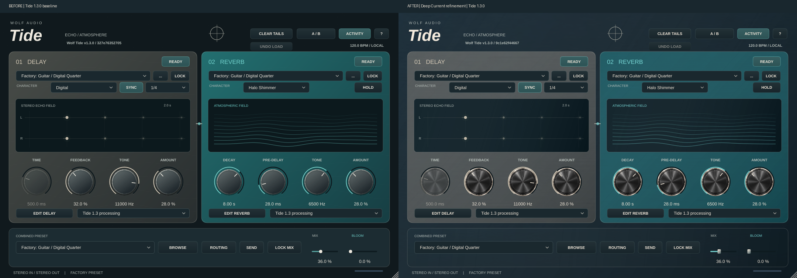

# Wolf Tide 1.3.0 — Deep Current refinement validation

## Visual changes and source

Branch: `ui/deep-current-refinement`. Frozen source: `a54c5f143e01b0d3e7b56eb587881e2232248041`.
Baseline build ID `327e76352705`; new build ID `9c1e62f44667`. Version remains **1.3.0**.
Bundle `audio.wolf.tide`, manufacturer `Wolf`, plugin `Wtid`, AU/VST3 identities unchanged.
Processor/DSP/parameter sources also match `development/tide-1.3` at `bbfbedda125c65357c5d07cc907ff0a46c598ce4`.

Refined cached satin chassis, graphite delay panel, teal reverb panel and dark glass;
static machined knob caps with existing live vector arcs/pointers; machined linear
thumbs; ivory/shared palette on main, legacy, independent machine and browser views.
Original Wolf Audio/Tide branding, two-panel/footer layout and existing sans system
remain. No third-party font was added. One visual cache fix prevents a stale heading
when switching between equal-size expanded legacy pages.



## Files changed

- `Source/PluginEditor.cpp`: shared immutable images, cached material composition,
  knob artwork, slider thumb painting and backdrop page key.
- `Source/PluginEditor.h`: backdrop page key only.
- `Source/TideLook.h`, `Source/ModernPanel.h`, `Source/PresetBrowser.h`: shared colors
  and independent-page separator; bindings/events are unchanged.
- `CMakeLists.txt`: embedded resource target and asset-inclusive build fingerprint.
- `assets/tide/deep-current/production/`: five PNGs, provenance/size manifest and README.
- `scripts/prepare-deep-current.py`, `scripts/check-deep-current.py`,
  `scripts/source-archive.py`: reproducible artwork preparation, preservation guard,
  and corresponding-source archive resource inclusion.
- `tests/ui_tests.cpp`: regression check for equal-size legacy page headings.
- `tests/ui_refresh_checks.cpp`: broader screenshot capture, including full scrolled content.
- Deep Current implementation/validation documents, frozen method hashes and evidence.

No processor, DSP, parameter, preset, serialization or audio callback files changed.

## Controls and views verified

The existing UI tests passed: 64 combined programs, 50 side starters, 206 portable
presets, independent user names, project recall, automation/modified indicators,
1024 lock combinations, browser refresh and compiled release label. Existing DSP,
model, repair, modern controls, stress, host and modern host suites also passed.
The new visual regression check passed for Delay → Reverb at unchanged window size.

The preservation guard confirms 214 protected file hashes and 14 complete editor
methods unchanged, including constructor/attachments, geometry, input handlers,
menu commands, timer and delay-tap/reverb-wave methods. Thus Sync/subdivision,
Lock/Hold, Clear Tails, Undo Load, A/B, Activity, Browse, Routing, Send, Lock Mix,
Mix and Bloom retain their prior implementation. This is source/test evidence,
not a claim that every mouse gesture was manually exercised in a DAW.

70 PNG captures: main at 900/1080/1620 and simulated 2×; five independent pages
and their full control lists; all 12 delay and 13 reverb algorithm pages plus full
control lists (including Oil Can and Glint); three preset-browser scopes; and
legacy Delay/Reverb/Routing expanded pages. Full-content captures retain transparent
backgrounds because the actual content inherits its parent background. Main,
advanced, browser, Oil Can/Glint and legacy Reverb images were visually inspected.
Menus, tooltip/focus/hover/pressed states, native dialogs and every native gesture
were not exhaustively screenshot-tested. Existing rendering/state treatment remains.

## Automated results actually run

- Full Release build: Linux standalone, VST3 and all test executables succeeded.
- CTest: **11/11 passed**, 45.34 seconds, including installer, DSP, update, models,
  repairs, modern DSP/stress/controls, host, UI and modern host.
- Linux pluginval: **strictness 5, GUI tests enabled, SUCCESS**.
- Frozen-source/editor-method guard: PASS. Diff whitespace check: PASS.
- Deterministic 64-program audio fixture: **byte-identical**, 48 kHz / 256 samples,
  12,582,912 bytes per build. SHA-256: `10667ab972dc01517d67d20c9a52d37592bb79cee6177ca84d73713f9f8df728`.

These checks do not establish native macOS AU/DAW compatibility for this revision.

## CPU, graphics and memory

Machine details are in `evidence/refinement/machine.json`: Linux x86-64, GCC 14,
JUCE pinned `29396c22c93392d6738e021b83196283d6e4d850`, Xvfb 1920×1200,
software rendering, 2-CPU quota and 8 GiB memory limit. No DAW or GPU telemetry.

The existing benchmark performs audio batches plus a **forced full-editor paint**
at a requested 30 Hz, in addition to normal window events. Closed runs have no editor.
Three alternating baseline/candidate trials were run per case. CPU below is total
process CPU (100% = one CPU); paint is aggregate full-paint time for all editors.
These are synthetic stress figures, not idle UI or normal DAW frame times.

| Instances | Editors | CPU % before → after | Forced paint ms before → after | Peak RSS MiB before → after |
|---|---|---:|---:|---:|
| 1 | closed | 6.5 → 5.5 | 0.00 → 0.00 | 65.0 → 65.4 |
| 1 | open | 51.7 → 49.1 | 11.77 → 11.18 | 93.5 → 94.1 |
| 4 | closed | 18.9 → 19.0 | 0.00 → 0.00 | 245.2 → 244.9 |
| 4 | open | 119.3 → 118.9 | 45.22 → 48.10 | 321.6 → 321.2 |
| 8 | closed | 38.8 → 38.5 | 0.00 → 0.00 | 485.4 → 485.3 |
| 8 | open | 132.6 → 152.0 | 92.78 → 108.03 | 619.8 → 619.4 |
| 16 | closed | 72.6 → 73.5 | 0.00 → 0.00 | 965.8 → 966.1 |
| 16 | open | 163.6 → 176.6 | 186.18 → 289.53 | 1216.0 → 1215.5 |

RSS uses an additional isolated run per case, measured by `wait4.ru_maxrss`;
it is a single-run peak, not a leak-duration test. Across all cases the observed
RSS difference was under 1 MiB. No sustained GPU-memory claim can be made.

The first open-editor stress pass showed slower candidate paint medians at 8/16.
Three additional alternating trials reversed that result:

| Open editors | Repeat paint median before → after (ms) |
|---|---:|
| 8 | 98.49 → 91.19 |
| 16 | 308.40 → 205.27 |

This variability prevents a stable performance acceptance claim. The stressed
8/16-window cases miss the requested 30 Hz cadence on both builds, and audio-batch
peaks can exceed the 5.33 ms block interval. No DAW dropout count was measured.
No reproducible new regression was isolated; the animation/paint update mechanism
was preserved rather than lowering quality or imposing a new frame-rate cap.
**Native normal-window, 1/4/8/16-editor, Retina, GPU and dropout profiling remains
an open release gate.** Raw initial, repeat and memory-run records are included.

## Image differences and residual limits

The repo previews are 1200px derivatives, not the full-resolution original pack.
All 15 were checked for readable files, actual dimensions/mode/alpha and reviewed
as a contact sheet. Sources 01/02/03/05/08 supply clean material crops and the cap;
other sheets are style references. Generated controls, lettering, icon errors,
fixed arcs and invented layout are excluded. The cap's needle uses adjacent
material reconstruction; its outer alpha is cleaned. No new Higgsfield generation
was needed. Five 256×256 textures total 260,644 encoded bytes. Original references
remain separate. Production manifest records source hashes, actual crop rectangles
and decoded/encoded sizes. The system font requires no extra font license.

Native AU loading, Apple silicon/Intel builds, actual Retina behavior, real DAW
recall/automation/keyboard tests, long-run memory, signing and notarization remain
unverified. Existing algorithm capability/label and tail behavior are intentionally
unchanged. No production install was overwritten and no Mac installer is claimed.

## Reproduce and deliverables

From the branch checkout, with a C++17 toolchain and JUCE's platform dependencies:

```sh
cmake -S . -B build -DCMAKE_BUILD_TYPE=Release
cmake --build build --parallel 2
ctest --test-dir build --output-on-failure
python3 scripts/check-deep-current.py
build/tide_ui_refresh_checks --screens /absolute/path/to/screens
build/tide_ui_refresh_checks --audio /absolute/path/to/audio.bin
```

The Linux QA run used `FETCHCONTENT_SOURCE_DIR_JUCE=/workspace/tide-deps/JUCE`,
the extracted dependency sysroot and a live Xvfb display. GUI commands need a display.
On macOS use `bash scripts/Build-Mac.command`; this invokes the existing universal
AU/VST3/standalone/package workflow. Native validation/signing still must run there.
Pillow is needed only to regenerate textures, not to build or run the plugin.

The GitHub branch is the reviewable source deliverable; GitHub's **Download ZIP**
provides its source archive. All runtime resources are checked in, and CMake fetches
pinned JUCE if no local/vendor copy is supplied. For a complete offline corresponding
source package, `python3 scripts/source-archive.py /absolute/path/Tide-Source.zip`
includes the pinned JUCE source and the curated resources.

Screenshots, test logs, raw measurements and audio-comparison metadata are in
`docs/deep-current/evidence/refinement/`. The large transient audio fixtures are
not committed; their equality, size and hashes are recorded. See IMPLEMENTATION.md
for the resource/threading decisions. This is a review candidate, not a claim of
native production release acceptance.
